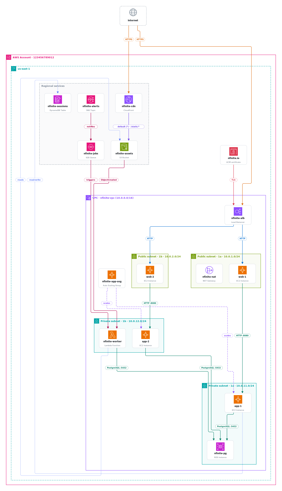

# blueprint\_ — your AWS architecture, drawn while you sleep

> Part of the [3am\_](https://3am.engineer/) open-source stack. MIT licensed.
>
> Built over a long weekend, AI-assisted, at — when else — 3am. Reviewed,
> tested, and used on real accounts by humans. PRs welcome.

Scan an AWS account — by tag, VPC, or the whole account — infer the
relationships between resources, and generate a **self-contained HTML portal**
that renders an architecture diagram using the official AWS icon set, with
one-click **SVG** and **PNG** export.



## What it does

1. **Discovers** all resources with a tag (key, or key=value) via the
   [Resource Groups Tagging API], across one or many regions.
2. **Enriches** the common architecture services (EC2/VPC/subnets, NAT & internet
   gateways, ELBv2, RDS, ElastiCache, EFS, Lambda, Auto Scaling, ECS services,
   EKS clusters) so resources land in the right VPC/subnet, and infers
   **labeled connectors**:
   - load balancer → targets (EC2 or ECS services), Auto Scaling group →
     instances, ECS cluster → services
   - **event flow** — Lambda event-source mappings (SQS/DynamoDB/Kinesis →
     function), SNS topic subscriptions (topic → queue/function), and S3 bucket
     notifications (bucket → Lambda/SQS/SNS)
   - **CloudFront** — distribution → origin edges from the distribution config,
     labeled with the cache-behavior path patterns (`default (*)`, `/static/*`);
     S3 origins, ALB origins, plus OAC *and* legacy OAI grants
   - **IAM role access** — each EC2 instance-profile and Lambda execution role
     is resolved and its inline + customer-managed policies parsed; grants on
     scanned resources become dashed connectors (instance → bucket
     `read/write`, function → table `reads`). `Resource: "*"` statements and
     AWS-managed policies are skipped to keep the signal high.
   - **ACM certificates** — `InUseBy` yields certificate → load balancer /
     CloudFront `TLS` edges
   - **resource-policy analysis** — bucket, queue, topic, and Lambda resource
     policies are parsed for `aws:SourceArn` grants (exact or wildcard) and
     service principals, yielding connectors like SNS → SQS, S3 → Lambda,
     EventBridge/API Gateway → Lambda, and *access logs* / *trail logs*
     deliveries into buckets — even when only one side carries the tag. Any
     resource whose policy allows `Principal: "*"` without conditions gets the
     orange *open to the internet* badge.
   - **security-group traffic flow** — if SG-B allows ingress from SG-A on a
     port, an edge is drawn between the resources in each group, labeled by
     protocol/port (HTTP, MySQL :3306, Redis :6379, NFS :2049, …). This is where
     most of the real topology comes from.
   - parallel connectors between the same pair are **merged** into one edge with
     a combined label (e.g. `HTTP :80 · HTTPS :443`).
   - `0.0.0.0/0` ingress draws a real *Internet* connector only into entry
     points (load balancers, CloudFront, API Gateway, IGW). Anything else that
     is world-open gets a small orange globe **badge** on its card instead, so a
     permissive account doesn't turn into a wall of orange lines.
3. **Groups** everything into nested containers: `AWS Account → Region → VPC →
   public/private Subnet` (green/blue, matching the official AWS reference
   diagrams), plus a *Regional services* box for S3, DynamoDB, SQS, SNS,
   CloudFront, etc. Low-signal resources (AMIs, snapshots, volumes, ENIs,
   route tables, security groups, alarms — plus VPCs/subnets themselves, which
   are already drawn as containers) are **hidden by default** to keep the
   diagram readable — pass `--show-all` to include them.
4. **Lays out** the graph with [elkjs] and **renders** an interactive portal
   (pan, zoom, search, legend, resource list) plus a standalone `diagram.svg`.
   Click any resource — in the diagram or the sidebar — to highlight its
   connections and open an **inspector panel** with its ARN, placement,
   security groups, instance/engine details, and tags.

Icons are embedded as base64 data URIs, so the SVG/HTML and PNG export work
completely offline with no external references.

## Install

```bash
npm install -g 3am-blueprint
blueprint fetch-icons           # downloads the official AWS icon set
                                # to ~/.blueprint/icons/aws (one time)
                                # other providers: fetch-icons azure|gcp|oci|all
blueprint                       # interactive TUI
```

Or from a checkout:

```bash
git clone https://github.com/3am-engineer/blueprint.git
cd blueprint
npm install
node bin/blueprint.js fetch-icons
node bin/blueprint.js
```

Requires Node 18+. The icon set is looked up in `--icons-dir`,
`$BLUEPRINT_ICONS_DIR`, `./icons`, `~/.blueprint/icons`, then the package
directory. The icons themselves are © AWS and are downloaded from AWS
directly — they are not bundled in this repo or the npm package.

## Usage

### Interactive TUI

Run `blueprint` (or `node bin/blueprint.js`) with no arguments to get an
interactive terminal wizard: pick a scope (tag / VPC / whole account), an AWS
profile (auto-detected from `~/.aws`), regions, and grouping; watch scan
progress live; then open the rendered portal straight from the menu. The TUI
can also re-render saved scans, fetch provider icon sets, and start the web UI.

### Flags (scriptable)

```bash
# Scan a profile for a tag value and open the portal
node bin/blueprint.js --tag Project --value acme --profile prod --out out/acme

# Any resource that simply has the tag key (any value)
node bin/blueprint.js --tag Environment --profile staging

# Sweep every enabled region (slower)
node bin/blueprint.js --tag Project --value acme --all-regions

# Re-render from a saved scan, no AWS calls (great for tweaking / offline)
node bin/blueprint.js --from-json out/acme/scan.json --out out/acme
```

Then open `out/<...>/index.html` in a browser.

### Scopes

```bash
node bin/blueprint.js --tag Project --value acme --profile prod     # by tag
node bin/blueprint.js --vpc vpc-0abc123 --region ap-southeast-1     # one VPC
node bin/blueprint.js --account --all-regions --profile prod        # whole account
```

### Grouping modes

```bash
--group-by network   # default: Account → Region → VPC → subnet (+ EKS clusters)
--group-by type      # logical: Networking / Compute / Databases / Storage /
                     # Messaging / Security boxes — better for tall overviews
```

The web UI has the same toggle under "What to diagram".

## Web UI (self-hosted SaaS mode)

```bash
node bin/blueprint.js serve            # http://localhost:8787
node bin/blueprint.js serve --port 9000
```

A product-style web experience: a marketing landing page at `/` (features,
security, pricing) and the scanner app at `/app`, where users paste
**temporary AWS credentials** (access key, secret, session token), pick a
scope — tag, a VPC chosen from a live dropdown, or the whole account — and
regions, then scan and browse the interactive diagram (with a no-credentials
demo mode).

### Hosting it for others

```bash
# gate scans behind a shared code, bind publicly (behind your TLS proxy!)
ACCESS_CODE=my-invite-code node bin/blueprint.js serve --host 0.0.0.0 --port 8787

# or with Docker
docker build -t 3am-blueprint .
docker run -p 8787:8787 -e ACCESS_CODE=my-invite-code 3am-blueprint
```

Built-in protections for small-audience hosting: optional `ACCESS_CODE` gate
on all credential-touching endpoints (the demo stays open), 12-scans-per-15-min
per-IP rate limit, 2 h in-memory result TTL, localhost bind by default. Put
HTTPS in front (Caddy/nginx/Cloudflare) before sharing a URL — credentials
must never travel over plain HTTP. Works as-is on Fly.io, Railway, or any
VM with Docker.

**Credential handling:** keys are sent to *your* server only, used for that
one scan, held in memory, never persisted and never logged. Rendered diagrams
are cached in memory for 2 h (no credentials in them). The server binds to
`localhost` — to expose it publicly, put a TLS reverse proxy in front.

**Before offering this as a real SaaS**, switch from pasted keys to the
standard cross-account pattern: your service gets its own AWS identity, and
each customer creates a read-only IAM role in their account that trusts your
service's account with an **external ID**; the server then calls
`sts:AssumeRole` per scan. Users never share long-lived secrets, access is
revocable in their IAM console, and CloudTrail attributes every call.

### Options

| Flag | Description |
|------|-------------|
| `--tag <key>` | Tag key to scan for (required unless `--from-json`) |
| `--value <value>` | Only include resources whose tag value equals this |
| `--profile <name>` | AWS shared-config profile |
| `--region <list>` | Comma-separated regions (repeatable). Default: env/default region |
| `--all-regions` | Scan every enabled region |
| `--out <dir>` | Output directory (default `./out`) |
| `--icons-dir <path>` | Path to the AWS icon set (default `./icons`) |
| `--title <text>` | Portal header title |
| `--from-json <file>` | Render from a saved `scan.json` instead of calling AWS |
| `-h, --help` | Help |

### Output files (in `--out`)

- `index.html` — the browsable portal (pan/zoom, search, inspector, and an
  **Export** menu: PNG, SVG, draw.io, Mermaid, Excalidraw)
- `diagram.svg` — standalone vector diagram
- `diagram.drawio` — **editable** in [draw.io / diagrams.net]: same layout,
  real containers, icons embedded, edges stay attached when you drag nodes
- `diagram.mmd` — Mermaid flowchart (diagram-as-code; renders on GitHub)
- `diagram.excalidraw` — editable Excalidraw scene with embedded icons
- `scan.json` — the raw scan model (audit / re-render with `--from-json`)
- `diagram.json` — the laid-out geometry (debugging)

[draw.io / diagrams.net]: https://app.diagrams.net/

## Credentials & permissions

Uses the standard AWS SDK credential chain; `--profile` selects a named profile
from `~/.aws/config` / `~/.aws/credentials`. Read-only permissions are enough,
e.g. `tag:GetResources`, `ec2:Describe*`, `elasticloadbalancing:Describe*`,
`rds:DescribeDBInstances`, `elasticache:DescribeCacheClusters`,
`elasticache:DescribeCacheSubnetGroups`, `elasticfilesystem:DescribeMountTargets`,
`lambda:GetFunctionConfiguration`, `lambda:ListEventSourceMappings`,
`autoscaling:DescribeAutoScalingGroups`, `ecs:DescribeServices`,
`eks:DescribeCluster`, `sns:ListSubscriptionsByTopic`,
`cloudfront:GetDistribution`, `s3:GetBucketNotification`, `s3:GetBucketPolicy`,
`sqs:GetQueueAttributes`, `sns:GetTopicAttributes`, `lambda:GetPolicy`,
`acm:DescribeCertificate`, `iam:GetInstanceProfile`, `iam:ListRolePolicies`,
`iam:GetRolePolicy`, `iam:ListAttachedRolePolicies`, `iam:GetPolicy`,
`iam:GetPolicyVersion`, `sts:GetCallerIdentity`.

If no region is given, the profile's configured region is used; add
`--all-regions` to sweep everything.

## How it's built

```
bin/blueprint.js  CLI entry (flags → pipeline, no args → TUI)
src/tui.js        interactive terminal wizard (@clack/prompts)
src/pipeline.js   shared scan → graph → render pipeline
src/args.js       argument parsing + help
src/scan.js       tagging-API discovery + per-service enrichment
src/icons.js      indexes the AWS icon set, resolves service/group icons
src/graph.js      containers + nodes + inferred edges (logical model)
src/render.js     elkjs layout → SVG → self-contained HTML portal
src/server.js     self-hosted web UI (express)
scripts/          icon-set fetchers (aws / azure / gcp / oci)
examples/         sample scans for offline demos
```

See [CONTRIBUTING.md](CONTRIBUTING.md) for dev setup and
[SECURITY.md](SECURITY.md) for how credentials are handled.

### Extending

- **More services in the diagram legend/icons:** add entries to `ICON_MAP` in
  `src/icons.js` (keyed by `service` or `service:resourceType`). Unmapped
  services still appear via a fuzzy match against icon file names, or a neutral
  fallback tile.
- **More inferred connectors:** add enrichment + `scan.edges.push({from,to,label,kind})`
  in `src/scan.js`. The renderer draws any edge whose endpoints are both nodes.
- **Placement rules:** `isRegionalService()` and the container logic in
  `src/graph.js` decide whether a resource sits in a subnet, a VPC, or the
  Regional services box.

[Resource Groups Tagging API]: https://docs.aws.amazon.com/resourcegroupstagging/latest/APIReference/Welcome.html
[elkjs]: https://github.com/kieler/elkjs
